# Tài's role in unified retrieval

You turn audio, video speech, and PDF pages into text that can be searched and traced back to its source. You also investigate how speech-recognition errors affect the evidence that search returns.

The team will use your output to answer questions about messages and shared files. A useful answer might cite a PDF page or a time interval in a recording. Producing those inspectable locations is part of your work.

This guide follows the team's research briefs and the repository state on 12 November 2026. The diagrams describe the intended research flow. The status table below identifies the existing implementation. Examples and arithmetic exercises are synthetic.

Open this file in VS Code and press **Ctrl+Shift+V** to preview it. The diagrams are rendered SVG images, so previewing them requires no Mermaid extension. Keep the adjacent `diagrams` folder with the guide when copying it.

## Read according to the question you have

| Your question | Start here |
|---|---|
| Where does my work fit? | [The complete flow](#the-complete-flow) |
| What do I build and give the team? | [From files to evidence](#from-files-to-evidence) and [Your handoffs](#your-handoffs) |
| What am I investigating? | [The paired experiment](#the-paired-experiment) |
| How do I interpret the numbers? | [WER](#understanding-word-error-rate) and [retrieval measurements](#connecting-transcription-to-retrieval-measurements) |
| What should I deliver each week? | [The four-week plan](#the-four-week-plan) |

## The complete flow



**Ingestion** is the process of turning an input file into usable evidence. Your extraction and transcription components sit here. **Retrieval** selects relevant passages for a question. Quân and Thiện own the retrieval methods. **Answer generation** can later use those passages to compose a response and cite its evidence.

Xuân Ngân defines the benchmark and coordinates scoring. Hào coordinates the research question, interfaces, controlled experiment, and integration. The main research comparison concerns retrieval quality across messages, PDFs, audio transcripts, and video transcripts.

| Component | Current state |
|---|---|
| Messaging, private attachments, and browsing shared items | Implemented in the app |
| PDF text extraction with physical page numbers | Implemented as a standalone local experiment in `tools/pdf-extraction` |
| Audio transcription and video audio extraction/transcription | Planned research work |
| Automatic extraction after an upload, durable jobs, and retries | Planned application integration |
| Keyword search, dense search, reranking, and cited answers | Planned retrieval and generation work |

The PDF experiment demonstrates one input path. Your full responsibility includes media processing, transcript review, error analysis, reproducibility, and coordination with the retrieval experiment. The existing tool has its own run instructions. [PDF experiment](../../tools/pdf-extraction/README.md)

## From files to evidence



### Audio

An audio file contains encoded sound. The processing path decodes and prepares it, runs automatic speech recognition, and returns text with time intervals.

**ASR** means automatic speech recognition. The team's proposed baseline is **Whisper large-v3**. Whisper predicts text from audio and supports multilingual transcription. The model configuration, language setting, software revision, and inference options all belong in the experiment record. Its official implementation uses FFmpeg to decode input media. [Whisper documentation](https://github.com/openai/whisper)

A transcript segment might contain the words spoken from 12.4 to 18.9 seconds. Check those offsets against the recording. Generated timestamps need validation before they can support precise citations.

Record silence, unintelligible speech, and processing failures according to the annotation procedure. Reviewers should transcribe what is audible. Corrections to a reference transcript should preserve what the speaker actually said.

### Video

A video container can include separate video and audio streams. Select its audio stream, prepare it, and send that audio through the transcription path. FFmpeg provides stream selection and audio conversion. Preserve the relationship between extracted audio time and the original video time, including any trimming offset. [FFmpeg documentation](https://ffmpeg.org/ffmpeg.html)

Your initial video evidence covers spoken content and its original timestamps. Understanding objects, slides, or actions visible in frames is a separate scope decision in the project vision.

### PDF

Extract text page by page and retain the physical PDF page number. Physical page 1 includes a cover page when one exists, so a printed page label can differ.

Check reading order, columns, tables, and technical notation against the original. A page with no extracted text may be blank or contain a scanned image that needs optical character recognition, or **OCR**. The local extractor marks it `no_text` for review. [pypdf extraction documentation](https://pypdf.readthedocs.io/en/stable/user/extract-text.html)

### Shared output

The three paths converge on text plus provenance. **Provenance** records where a piece of evidence came from and how it was produced.

| Term | Meaning in your work |
|---|---|
| Source | An original attachment, recording, or message |
| Segment | A bounded piece of a source, such as a transcript time interval |
| Chunk | A passage selected for indexing using the team's chunking rules |
| Source location | A physical PDF page or an original-media time interval |
| Transcript variant | The automatic or human-corrected text for the same source interval |
| Processor version | The extraction/transcription software and model revision used |

A segment boundary can reflect audio timing. A chunk boundary can reflect the indexing strategy. Agree with Hào and Quân on how the chunking step consumes your segments and preserves their locations.

## Preserve the route back to the source


Consider a synthetic recording called `meeting-001.mp4`. A passage comes from 12.4 to 18.9 seconds. A later search result should retain that source ID and interval through extraction, chunking, indexing, and ranking. The user can then inspect that interval in the original video.

If preprocessing removes the first 10 seconds, a local offset of 2.4 seconds corresponds to 12.4 seconds in the original. Store that mapping. Apply the same principle when joining clips or selecting channels.

The following record is a **proposed transcript interface for discussion with Hào and Quân**. The existing PDF extractor uses its documented page-record format.

```json
{
  "source_id": "meeting-001",
  "conversation_id": "conversation-example",
  "source_type": "video",
  "segment_id": "meeting-001-segment-003",
  "variant": "asr",
  "start_seconds": 12.4,
  "end_seconds": 18.9,
  "text": "The Atlas demo is on Friday.",
  "language": "en",
  "processor": "whisper-large-v3",
  "model_revision": "<record the exact revision>",
  "processing_config_id": "<reference the saved settings>"
}
```

The matching corrected record retains the same source, interval, and segment ID. Its variant and text identify the reviewed representation. Downstream chunks need IDs that distinguish their transcript variants while retaining a common source-location mapping for evaluation.

Conversation IDs support application authorization when these components are integrated. The application must enforce membership when supplying files and returning evidence. Derived transcripts, chunks, and indexes also need retention and deletion behavior tied to their sources. Local experiment copies have their own lifecycle, as described in the PDF experiment guide.

## Why transcription errors matter



Two synthetic examples show different failure paths.

| Spoken content | Automatic transcript | What to investigate |
|---|---|---|
| The Atlas demo is on Friday. | The Alice demo is on Friday. | A question mentioning Atlas may have difficulty finding the passage |
| The meeting starts at nine on Monday. | The meeting starts at five on Monday. | Search may find the passage, while the transcribed time is wrong |

The first example concerns evidence discovery. The second concerns the accuracy of the evidence text. A citation can lead to the right recording interval even when the automatic transcript changes a fact.

For each case, inspect the recording, transcript, ranked search result, and source location. If answer generation is evaluated, distinguish faithfulness to retrieved text from correctness against the original recording. Those can diverge when ASR changes the content.

Use error categories that connect to a consequence.

| Error category | Example | Possible consequence |
|---|---|---|
| Name or identifier | Atlas becomes Alice | Relevant evidence becomes harder to locate |
| Number, date, or time | Nine becomes five | The retrieved text contains an incorrect value |
| Negation | A spoken “not” is omitted | The meaning of a statement reverses |
| Technical term | A model name becomes a common word | Exact terminology is lost |
| Relationship | Who approved an action changes | The transcript attributes a fact incorrectly |
| Timing | The right text has a shifted interval | A citation points to the wrong moment |

These are hypotheses about consequences. Your experiment establishes which occur in the pilot.

## The paired experiment

Your central question is **how retrieval changes when the same recordings are represented by corrected transcripts or automatic transcripts**.



1. Select synthetic or consented recordings and assign stable source IDs.
2. Produce automatic transcripts with a recorded model/configuration.
3. Create corrected reference transcripts by reviewing the same recordings.
4. Align both representations to common source intervals.
5. Build separate corpus/index versions for the two transcript conditions. Keep messages, PDF text, and other unchanged content identical.
6. Run the same questions and retrieval configurations on both versions.
7. Compare scores per question, then inspect cases where the outcome changes.

Use labels tied to original evidence locations so both variants can be matched to the same underlying evidence. A reviewed reference transcript is the basis for WER. A benchmark evidence label identifies the passage or interval needed for a question.

### What stays controlled

| Element | How the comparison uses it |
|---|---|
| Recordings and source IDs | Identical underlying material |
| Questions and data split | Identical questions in corresponding runs |
| Evidence labels | Common source-location targets and accepted alternatives |
| Segmentation | Common intervals for paired transcript comparison |
| Chunking | Agreed rules and a documented mapping back to common intervals |
| Retrieval model and settings | Identical within each corrected-versus-ASR pair |
| Top-k and reranker candidates | Identical cutoffs within each pair |
| Language and normalization | Explicit, repeatable rules |
| Runtime conditions | Recorded hardware, versions, warm/cold state, and timing boundary |

Using the same token-count chunking settings can still produce different boundaries when transcript lengths differ. For the paired experiment, agree on an alignment method or common interval-based evaluation units. Record boundary changes so an observed effect can be interpreted.

### How it connects to the team's retrieval comparison

| Retrieval condition | Corrected-transcript corpus | ASR-transcript corpus | Main owner |
|---|---|---|---|
| BM25 | Run the fixed question set | Run the same question set | Thiện |
| BGE-M3 dense retrieval | Run the fixed question set | Run the same question set | Quân |
| Dense retrieval followed by BGE-reranker-v2-m3 | Run the fixed question set | Run the same question set | Quân and Thiện |

This matrix describes planned comparisons. Each completed run needs its own configuration and results. The initial reranking plan uses 50 dense candidates and returns 10 results, subject to the team's hardware/runtime decision. Hybrid retrieval is an optional extension in the briefs.

Each corpus version should remain a unified collection of the agreed source types. Correct source-type labels are used for analysis after retrieval. The question path receives the question and authorized corpus scope.

## Understanding Word Error Rate

**Word Error Rate**, or **WER**, measures the edit operations needed to align recognized words to reference words.

```text
WER = (substitutions + deletions + insertions) / reference word count
```

A substitution replaces a reference word. A deletion omits one. An insertion adds one. Calculate the counts from a word-level alignment after the agreed normalization. Lower WER indicates fewer edit operations per reference word. Insertions can make WER exceed 100%. [WER metric definition](https://huggingface.co/spaces/evaluate-metric/wer/blob/main/README.md)

### A worked example

This arithmetic example is synthetic and uses lowercase, whitespace-separated English words.

```text
Reference          the meeting starts at nine on monday
ASR         please the meeting starts at five    monday
```

| Operation | Alignment decision | Count |
|---|---|---|
| Substitution | `nine` becomes `five` | 1 |
| Deletion | `on` is omitted | 1 |
| Insertion | `please` is added at the beginning | 1 |
| Reference words | `the meeting starts at nine on monday` | 7 |

`WER = (1 + 1 + 1) / 7 = 0.4286`, or approximately **42.9%**.

If only `nine` becomes `five`, WER is `1 / 7`, approximately **14.3%**. The time has still changed. Examine important facts alongside the aggregate error rate.

For a corpus-level WER, add the error counts across recordings and divide by the total reference word count. An average of per-recording WER values weights recordings differently. State which aggregation you report.

Save the normalization procedure with the run. Document casing, punctuation, numbers, language, and tokenization. For Vietnamese, agree on the tokenization unit before comparing results. Reference transcripts need a review procedure and a way to mark uncertain speech.

## Connecting transcription to retrieval measurements

Quân and Thiện supply ranked results. Xuân Ngân defines their scoring against the benchmark. You supply the transcript conditions and help explain changes associated with ASR errors.

| Measurement | What you learn from it |
|---|---|
| WER | How much the transcript differs from the reviewed words |
| Recall@10 | How much labeled relevant evidence appears in the first 10 results |
| nDCG@10 | How well the first 10 results place relevant evidence near the top |
| MRR@10 | How early the first relevant result appears, with zero when it falls outside the first 10 |
| Candidate Recall@50 | Whether the evidence was present among the candidates available to the reranker |
| Complete Evidence@10 | Whether the first 10 results cover every required evidence group for a question |
| p50/p95 latency | Typical and slower-end query response times under recorded conditions |
| Attribution review | Whether a returned page or time interval points to the intended source evidence |

The conventional ranking metrics are supported by standard retrieval evaluators. Agree with Xuân Ngân on the relevance unit, treatment of unanswerable questions, relevance grades, and aggregation before interpreting the team's scores. Complete Evidence@10 follows the project's evidence-group protocol. [Retrieval evaluator documentation](https://www.sbert.net/docs/package_reference/sentence_transformer/evaluation.html)

A reranker reorders its supplied candidates. Check candidate recall when a final result misses the evidence. In the team's proposed reranking condition, candidate generation and reranking have separate latency measurements.

Your analysis can use a per-question worksheet.

| Field | What you record |
|---|---|
| Question ID and expected evidence | The benchmark question and original source location |
| Corrected-condition result | Rank, source interval, and score |
| ASR-condition result | Rank, source interval, and score |
| Recognition error | The changed words and error category |
| Observation | What changed in the returned evidence |
| Interpretation | A possible explanation, with uncertainties |

The 20–30 question target in the team plan is a pilot. Report the actual count, source mix, and coverage. Treat conclusions as preliminary and preserve examples that challenge the initial hypotheses.

## Your handoffs



| Teammate | What you provide | What you agree with them |
|---|---|---|
| Hào | Model note, processing flow, settings, hardware/runtime, failures, and limitations | Scope, common interfaces, controlled variables, and integration plan |
| Quân | Text segments with stable source IDs and original locations | Chunking, language assumptions, variant IDs, and evidence mapping |
| Thiện | The same searchable text and source metadata used by dense retrieval | Comparable inputs for BM25, dense retrieval, and reranking |
| Xuân Ngân | Corrected/ASR pairs, alignment notes, WER procedure, and error examples | Reference review, evidence labels, metric definitions, and scoring |

A reproducible handoff includes the input source/version, processor and model revision, configuration, output records, runtime measurements, and failure notes. Synthetic examples can be shared in the repository. Private experiment media and derived text need the team's consent and storage policy.

## Model choice and resource planning

The team brief names Whisper large-v3 as the baseline to investigate. Your model note should explain the choice using primary documentation, then record what the chosen implementation can actually run on the experiment hardware.

Distinguish Windows RAM, WSL's RAM allocation, and GPU VRAM when planning a run. During this onboarding, WSL was configured with a 4 GB memory cap. Include the active limit in your environment record because the WSL environment is shared by Docker and its Linux workloads. Record the execution environment, compute device, precision, peak memory, and processing time before deciding the pilot's inference setup.

If a different model or execution setting is selected, coordinate it with Hào and record the change. The optional alternative-model investigation should fit the four-week scope. Preprocessing choices, language detection, decoding settings, and model versions all affect reproducibility.

Local processing is the product's default direction for private conversation content. An external provider requires an explicit data-handling decision under the project rules.

## The four-week plan



The weeks are relative checkpoints from the team plan. Agree on calendar dates with Hào.

| Week | Work you complete | Evidence you can show |
|---|---|---|
| 1 | Study ASR, select representative samples, record language/consent/hardware constraints, and agree on the transcript format | A concise model note, sample inventory, proposed schema, and reference-review procedure |
| 2 | Demonstrate audio transcription, video audio extraction/transcription, and PDF extraction | Timestamped segments, page-numbered records, exact settings, and failure examples |
| 3 | Prepare corrected/ASR pairs, calculate WER, and coordinate retrieval runs | Aligned variants, reproducible WER results, comparable ranked outputs, and inspected errors |
| 4 | Assemble the demonstration and explain measured findings | WER/error analysis, corrected-versus-ASR retrieval results, runtime information, and limitations |

The local PDF experiment provides an initial example for Week 2. Audio/video processing and the controlled comparison remain the next substantial parts of this workstream.

## Your acceptance checklist

These deliverables follow your original research brief.

- [ ] An evidence-backed ASR model justification and limitation note.
- [ ] A repeatable audio/video transcription path with source IDs and timestamped segments.
- [ ] Repeatable PDF extraction with page references or explicit failure reporting.
- [ ] A paired corrected-versus-ASR sample and a documented WER procedure/results.
- [ ] Examples connecting particular recognition errors to retrieval outcomes.
- [ ] A configuration record that lets another teammate reproduce the pilot.

Use your original brief as the shared checklist of record. This guide explains the concepts and connections behind those deliverables. [Tài's research brief](tai-asr-media-processing.md)

## Explaining your work in the presentation

A clear presentation can follow four steps.

1. Show a source file and explain how it becomes timestamped or page-numbered evidence.
2. Explain the ASR baseline and the settings used for the pilot.
3. Show one corrected/ASR pair, its WER, and an error involving an important fact or term.
4. Show the corresponding retrieval outcomes, then state sample size, runtime, failures, and the limits of the evidence.

Label every result with its corpus/split, question count, transcript condition, retrieval configuration, and metric. Keep arithmetic examples visibly identified as examples. A successful demonstration should let a teammate inspect a retrieved passage and return to its original page or recording interval.

## Questions to check your understanding

| Question | Explanation you should be able to give |
|---|---|
| Why retain page numbers and timestamps? | A search result needs an inspectable location in the original evidence |
| How do segments and chunks differ? | Segments describe bounded source content, while chunks follow indexing rules and retain source mappings |
| Why compare two transcript variants from one recording? | It controls the underlying content while examining the effect of recognition errors |
| Why can a low WER still matter? | A small number of errors can change a key name, time, number, or negation |
| Why can search succeed while the content is wrong? | A relevant passage can still contain an ASR-induced factual change |
| What makes the experiment reproducible? | Stable inputs and labels, saved settings/versions, consistent comparisons, and documented scoring |

## Project references

- [Team research overview](README.md)
- [Tài's responsibilities](tai-asr-media-processing.md)
- [Hào's methodology and integration responsibilities](hao-methodology-lead.md)
- [Quân's dense retrieval responsibilities](quan-dense-retrieval.md)
- [Thiện's retrieval and reranking responsibilities](thien-retrieval-reranking.md)
- [Xuân Ngân's benchmark and evaluation responsibilities](xuan-ngan-benchmark-evaluation.md)
- [Project vision](../project-vision.md)
- [Implementation plan](../plan.md)

The diagrams' editable Mermaid sources are beside their SVG images in `diagrams/tai-*.mmd`.
